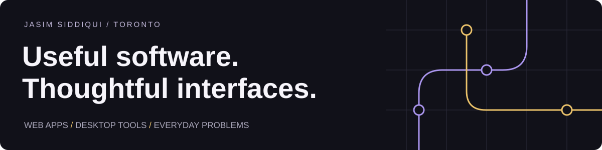
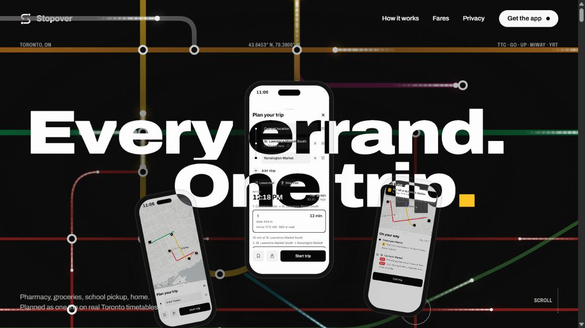
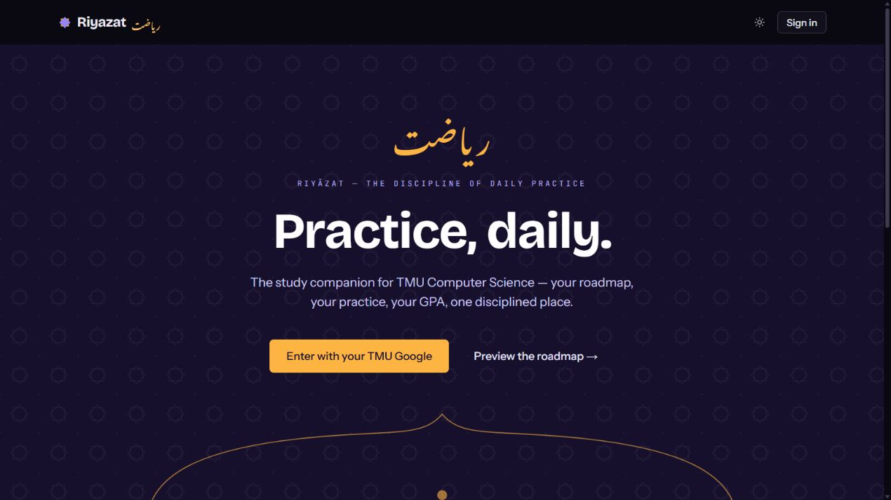
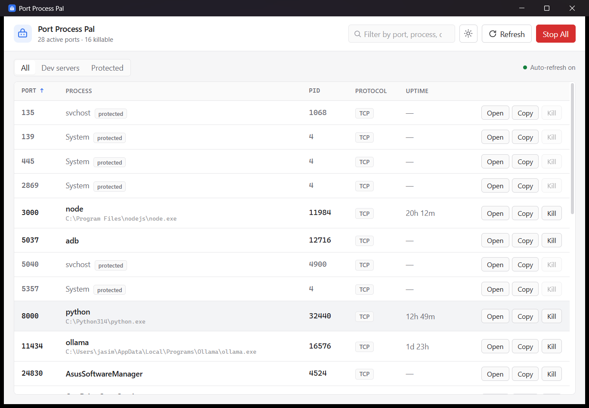
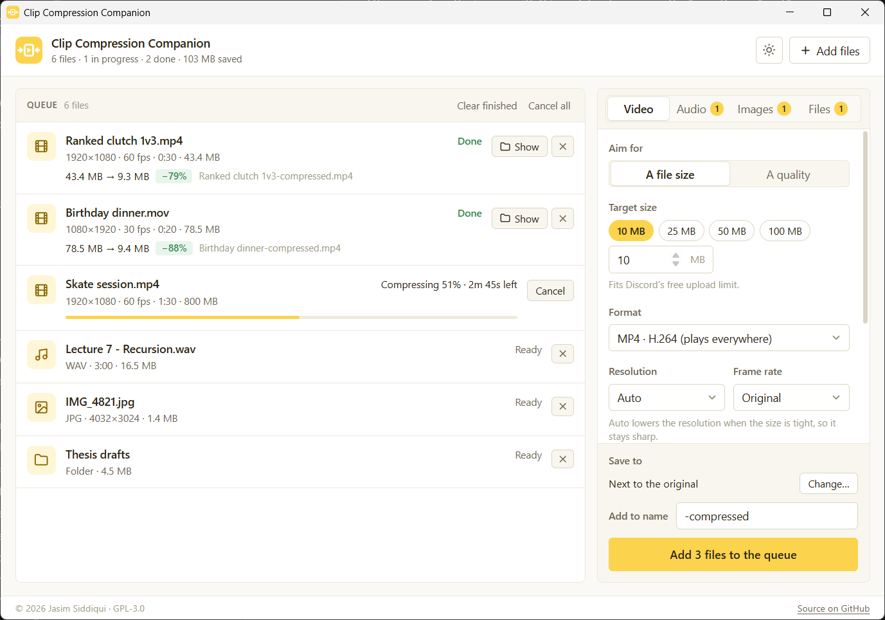

I build apps that make everyday friction disappear: planning a transit run, finding a moment in a lecture, or getting a file under an upload limit. I care about the interface **and** the engineering that makes it work.

[Email me](mailto:jasims.0002@gmail.com) · [Explore my repositories](https://github.com/JasimSiddiqui?tab=repositories) · He/Him

## Selected work

### 01 / Stopover
**Every errand. One trip.**

Transit apps usually plan one leg at a time. Stopover brings a whole errand run together, accounting for time at each stop, departure times, and transfer windows.

**Behind the interface:** timetable-based routing with OpenTripPlanner, stop-order optimization, and fare continuity across a multi-stop trip. A mostly monochrome UI keeps the transit line colours meaningful.

[Explore Stopover ↗](https://stopover-site.vercel.app/) · Mobile app in development

<b>Watch a trip come together · 22-second demo</b>

 

Actual app recording from the Stopover site.

### 02 / Riyazat
**Practice, daily.**

A study companion for TMU Computer Science that brings the degree roadmap, daily practice, and GPA planning into one place.

**Behind the interface:** prerequisite and elective rules, FSRS spaced repetition, browser-based Python practice, and GPA calculations that account for repeated courses. Designed around a daily study routine, with a distinct indigo-and-gold visual identity.

[Explore Riyazat ↗](https://riyazat-omega.vercel.app/) · TMU sign-in required for the app

## Small tools, real problems

Open-source desktop apps with focused interfaces and local processing.

<table>
<tr>
<td width="50%" valign="top">

<h3>Port Process Pal</h3>

<b>Find what is holding your port.</b> Inspect listening ports and reclaim them without hunting through terminal output.

Live table reconciliation, OS-specific process discovery, and protected processes excluded from bulk termination.

<code>Rust</code> <code>Tauri</code> <code>JavaScript</code>

<a href="https://github.com/JasimSiddiqui/port-process-pal">Code ↗</a> · <a href="https://portpal.vercel.app/">Download ↗</a>

</td>
<td width="50%" valign="top">

<h3>Tape to Transcript Tool</h3>

<b>Search the lecture instead of rewatching it.</b> Turn recordings into searchable transcripts on your own computer.

Background Whisper inference, timestamped SQLite storage, and GPU-to-CPU fallback. Works offline after the model download.

<code>Python</code> <code>PySide6</code> <code>Whisper</code>

<a href="https://github.com/JasimSiddiqui/tape-to-transcript-tool">Code ↗</a> · <a href="https://tapetotranscript.vercel.app/">Download ↗</a>

</td>
</tr>
<tr>
<td width="50%" valign="top">

<h3>Clip Compression Companion</h3>

<b>Make the file fit.</b> Pick an upload limit and compress video, audio, or images locally.

Bitrate budgeting, adaptive resolution, two-pass encoding, and hardware encoder detection with CPU fallback.

<code>Rust</code> <code>Tauri</code> <code>FFmpeg</code>

<a href="https://github.com/JasimSiddiqui/clip-compression-companion">Code ↗</a> · <a href="https://clipcompression.vercel.app/">Download ↗</a>

</td>
<td width="50%" valign="top">

<h3>Dynamic Downloading Dashboard</h3>

<b>Keep every connection working.</b> A Windows download manager with parallel transfers and resumable downloads.

Adaptive connection counts, work splitting between connections, server backoff, and disk-aware resume checkpoints.

<code>Rust</code> <code>Tokio</code> <code>Tauri</code>

<a href="https://github.com/JasimSiddiqui/dynamic-downloading-dashboard">Code ↗</a> · <a href="https://ddd-site.vercel.app/">Download ↗</a>

</td>
</tr>
</table>

### Also pinned: Clinica

[Clinica — Frontend](https://github.com/Adityasharma0101911/Clinica-Frontend) is a team hackathon project built around the doctor-visit journey: prepare, listen, understand. Explore the shared repository for the Next.js / TypeScript interface and architecture.

## What connects the work

**Clear interfaces.** Make the next action obvious, whether that is adding a stop or choosing a file-size limit.

**Useful engineering.** Handle the less visible parts: timing constraints, queue state, cancellation, fallback, and recovery.

**Local where it matters.** Keep recordings and media processing on the user's machine in the desktop tools.

---

<a href="mailto:jasims.0002@gmail.com">Let's talk about something worth building.</a>

