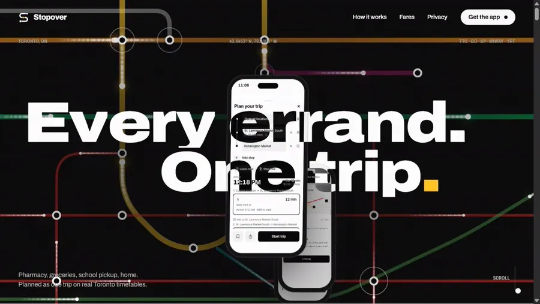
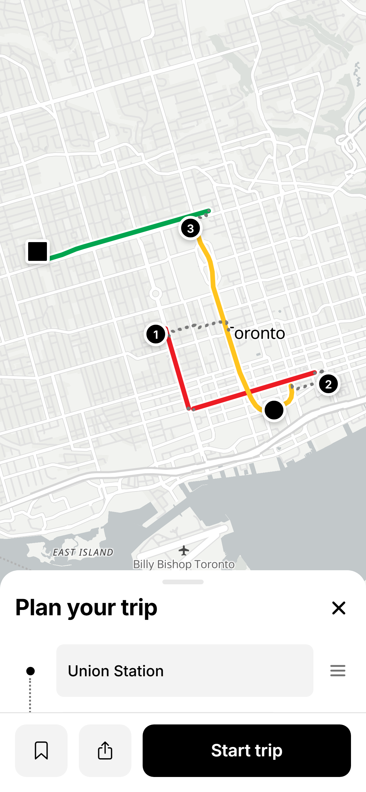
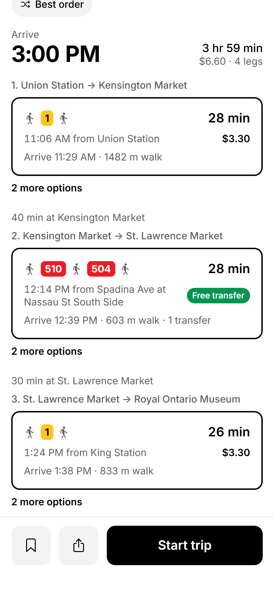
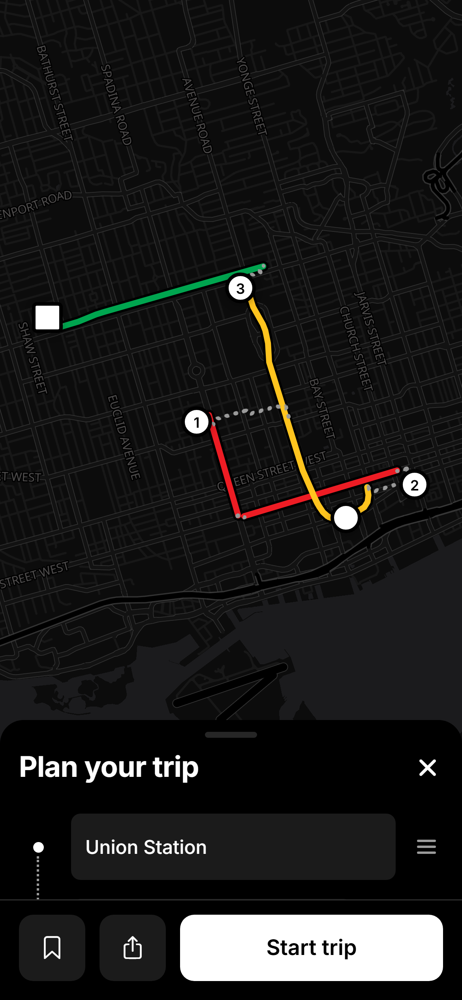
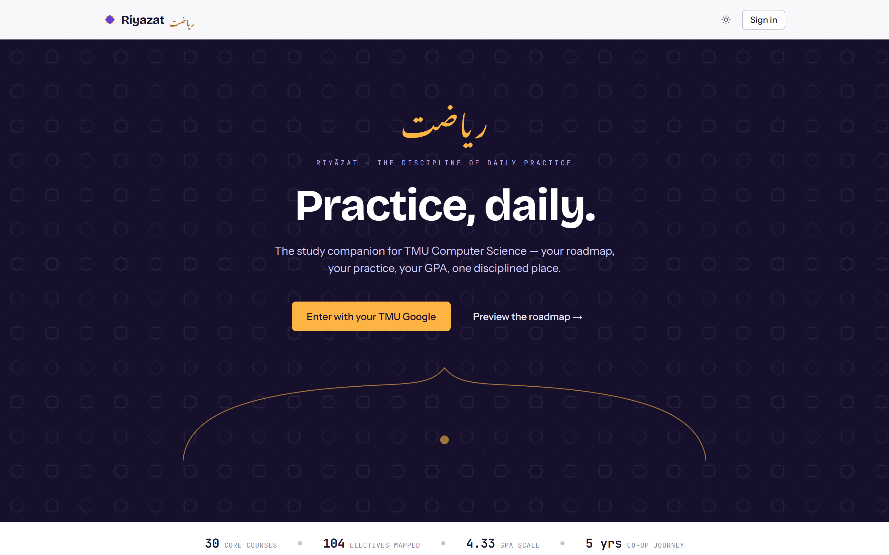
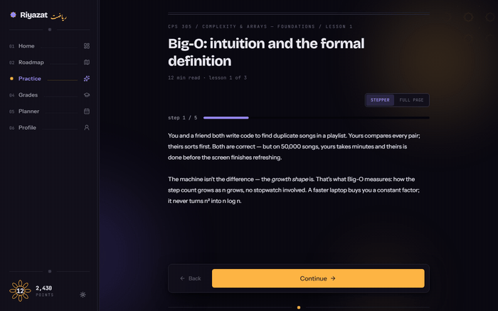
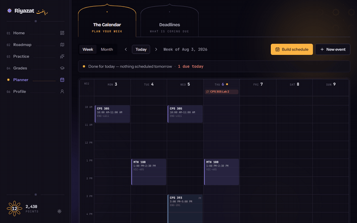
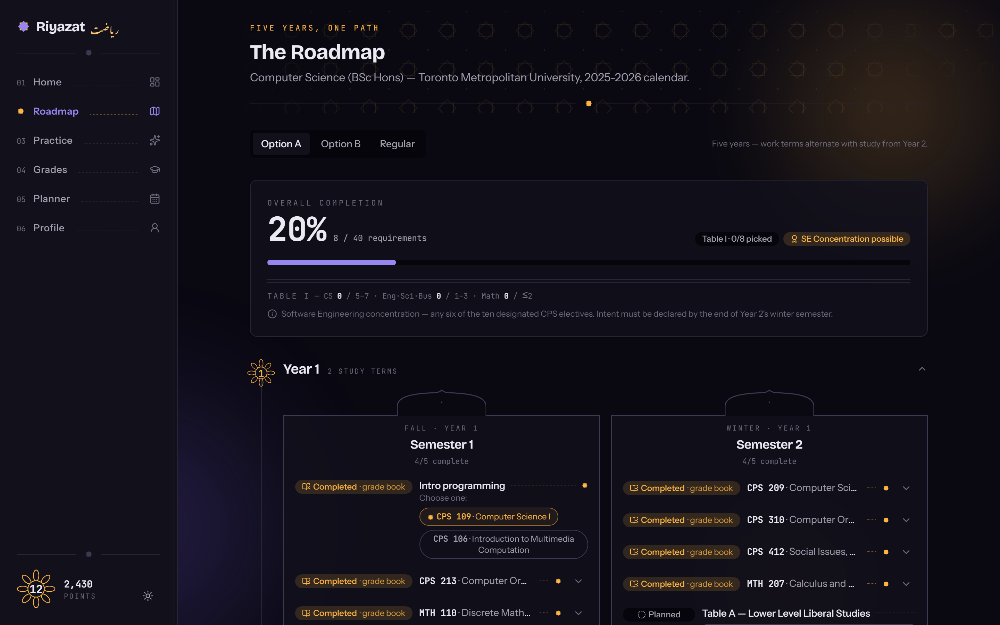
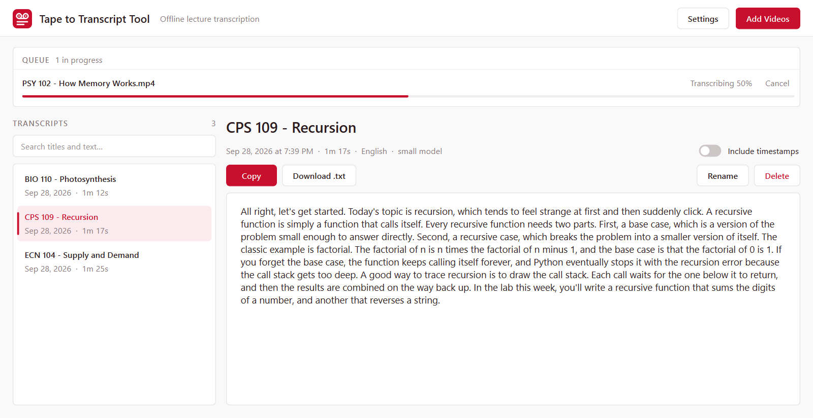
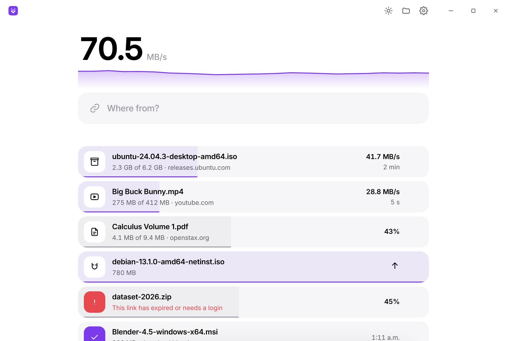

I build apps that make everyday friction disappear, with a **strong sense of user experience and visual aesthetics**. I care about how a product looks, how naturally it works, and the engineering behind it.

I've **won hackathons** and know how to **solve problems under pressure**: break down an unfamiliar challenge, prioritize what matters, and turn an idea into a working product on a tight deadline.

[Email me](mailto:jasims.0002@gmail.com) · [Explore my repositories](https://github.com/JasimSiddiqui?tab=repositories) · He/Him

## Selected work

### 01 / Stopover
**Every errand. One trip.**

**The website in motion.** A transit-map visual identity carried through animated routes, scroll-driven phone scenes, and a fare timeline. Built with TypeScript, Canvas 2D, GSAP, and Lenis, with reduced-motion support.

**The app behind it.** Stopover plans a whole errand run around time at each stop, real departure schedules, and transfer windows. OpenTripPlanner routing, stop-order optimization, and fare continuity do the work behind a mostly monochrome interface.

<table>
<tr>
<td width="33%" align="center" valign="top">

<b>The whole trip</b> Every stop on one quiet map.

</td>
<td width="33%" align="center" valign="top">

<b>Fares that carry forward</b> See which legs share a transfer.

</td>
<td width="33%" align="center" valign="top">

<b>Clarity in dark mode</b> The route stays the focus.

</td>
</tr>
</table>

[Explore Stopover ↗](https://stopover-site.vercel.app/) · Mobile app in development

Website tour captured from the live Stopover site; app screenshots from the Stopover app repository.

### 02 / Riyazat
**Practice, daily.**

A study companion for TMU Computer Science that brings the degree roadmap, daily practice, and GPA planning into one place.

**Behind the interface:** prerequisite and elective rules, FSRS spaced repetition, browser-based Python practice, and GPA calculations that account for repeated courses. Designed around a daily study routine, with an indigo-and-gold identity drawn from Pakistani and Islamic geometric traditions: ogee arches, manuscript rules, and generative course medallions.

<table>
<tr>
<td width="50%" valign="top">

<b>Practice with feedback.</b> Inline questions make learners commit to an answer before moving on.

</td>
<td width="50%" valign="top">

<b>Plan with a gesture.</b> Drag across the calendar to create a study block in the selected time slot.

</td>
</tr>
</table>

<b>Explore the degree roadmap</b>

 

[Explore Riyazat ↗](https://riyazat-omega.vercel.app/) · TMU sign-in required for the app

App screenshots and interaction recordings from my Riyazat portfolio; view them here without a TMU account.

## Small tools, real problems

Open-source desktop apps with focused interfaces and local processing.

<table>
<tr>
<td width="50%" valign="top">

<h3>Port Process Pal</h3>

<b>Find what is holding your port.</b> Inspect listening ports and reclaim them without hunting through terminal output.

Live table reconciliation, OS-specific process discovery, and protected processes excluded from bulk termination.

<code>Rust</code> <code>Tauri</code> <code>JavaScript</code>

<a href="https://github.com/JasimSiddiqui/port-process-pal">Code ↗</a> · <a href="https://portpal.vercel.app/">Download ↗</a>

</td>
<td width="50%" valign="top">

<h3>Tape to Transcript Tool</h3>

<b>Search the lecture instead of rewatching it.</b> Turn recordings into searchable transcripts on your own computer.

Background Whisper inference, timestamped SQLite storage, and GPU-to-CPU fallback. Works offline after the model download.

<code>Python</code> <code>PySide6</code> <code>Whisper</code>

<a href="https://github.com/JasimSiddiqui/tape-to-transcript-tool">Code ↗</a> · <a href="https://tapetotranscript.vercel.app/">Download ↗</a>

</td>
</tr>
<tr>
<td width="50%" valign="top">

<h3>Clip Compression Companion</h3>

<b>Make the file fit.</b> Pick an upload limit and compress video, audio, or images locally.

Bitrate budgeting, adaptive resolution, two-pass encoding, and hardware encoder detection with CPU fallback.

<code>Rust</code> <code>Tauri</code> <code>FFmpeg</code>

<a href="https://github.com/JasimSiddiqui/clip-compression-companion">Code ↗</a> · <a href="https://clipcompression.vercel.app/">Download ↗</a>

</td>
<td width="50%" valign="top">

<h3>Dynamic Downloading Dashboard</h3>

<b>Keep every connection working.</b> A Windows download manager with parallel transfers and resumable downloads.

Adaptive connection counts, work splitting between connections, server backoff, and disk-aware resume checkpoints.

<code>Rust</code> <code>Tokio</code> <code>Tauri</code>

<a href="https://github.com/JasimSiddiqui/dynamic-downloading-dashboard">Code ↗</a> · <a href="https://ddd-site.vercel.app/">Download ↗</a>

</td>
</tr>
</table>

### Also pinned: Clinica

[Clinica — Frontend](https://github.com/Adityasharma0101911/Clinica-Frontend) is a team hackathon project built around the doctor-visit journey: prepare, listen, understand. Explore the shared repository for the Next.js / TypeScript interface and architecture.

## What connects the work

**UX and visual craft.** Pair a distinct visual identity with clear hierarchy, useful feedback, and an obvious next action.

**Useful engineering.** Handle the less visible parts: timing constraints, queue state, cancellation, fallback, and recovery.

**Problem-solving in a crunch.** Bring the same focus that has helped me win hackathons: identify the core problem, make deliberate tradeoffs, and get the important flow working under a deadline.

**Local where it matters.** Keep recordings and media processing on the user's machine in the desktop tools.

---

<a href="mailto:jasims.0002@gmail.com">Let's talk about something worth building.</a>

